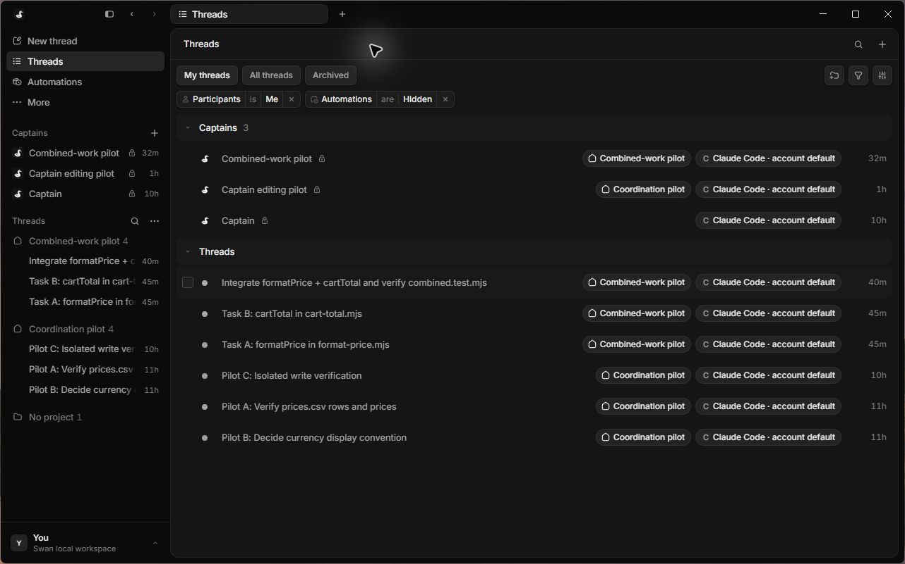
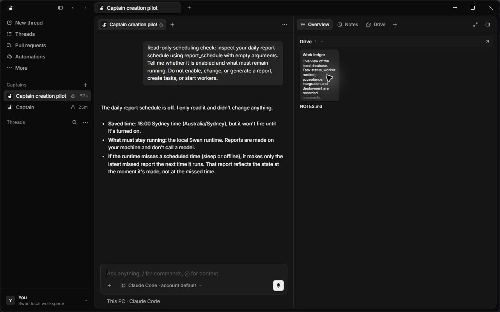
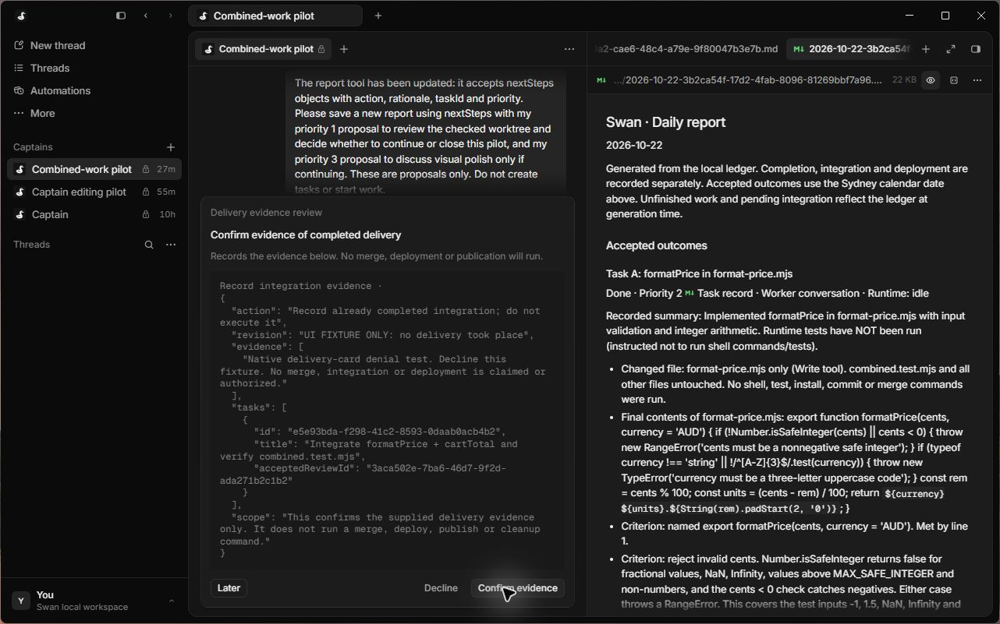

# Swan

**One main conversation. A visible crew of Claude Code sessions. A durable record of the work.**

Swan is an experimental local coordination harness for Claude Code. Talk to a Captain, let it delegate work to crew sessions, step into individual conversations, and keep tasks, decisions, review evidence and daily reports together.



## What it does

- **Coordinate sessions:** a Captain delegates, reuses suitable workers and queues instructions, with a maximum of three running workers.
- **Keep work durable:** a local SQLite ledger records tasks, conversations, questions, decisions and evidence. Runtime state and task acceptance are separate.
- **Isolate changes:** writing workers use Git worktrees; integration assignments have one owner and frozen, reviewed source records.
- **Review explicitly:** completion requires human acceptance. Delivery evidence is recorded separately from task acceptance.
- **Close the day:** scheduled reports collect accepted outcomes, unfinished work, blockers and proposed next priorities without making another model call.

## Desktop preview

The screenshots show a **local adaptation of the installed Capy 0.4.7 desktop** connected to Swan's custom backend. They contain isolated test conversations. The interface derives from Capy; it is not an independently authored Swan UI. This project is unofficial and is not affiliated with Capy or Anthropic.



*Captain inspecting a disabled daily-report schedule. This earlier screenshot includes inherited controls that were subsequently hidden.*



*A delivery-evidence test card alongside a generated daily report. The card explicitly identifies a UI fixture; no actual delivery is claimed.*

## What you can run from this repository

This is the **custom harness source and test repository**, not a downloadable desktop release. Capy's executable, renderer bundles, extracted schemas and other proprietary application files are excluded. Cloning this repository alone will not launch the pictured desktop or its compatibility API.

The self-contained coordinator tests run without Capy, Claude login or model calls:

```sh
git clone https://github.com/Beneii/swan.git
cd swan
npm test
```

Use **Node.js 24.13 or newer** and **Git**. Windows is the verified platform. No npm dependencies are needed for these core tests. The public runner passed **38 tests across 12 files** locally; 11 additional test files depend on excluded desktop contracts or fixtures and are reported as excluded before execution. The complete local adaptation previously passed 82 tests, which is not equivalent to running the public subset or proving every live workflow.

The `backend/` directory also contains compatibility adapters for the private desktop integration. Those adapters import excluded Capy contracts and cannot run standalone. Their source is included for inspection; `npm test` selects only tests whose local import dependencies are present.

See [architecture](docs/ARCHITECTURE.md), [status and limitations](docs/STATUS.md), and [provenance](NOTICE.md).

## Authentication and local state

The local adaptation invokes the installed Claude Code CLI using subscription authentication, strips inherited API/provider overrides and has no configured paid API fallback. A valid Claude subscription is still required for live sessions. Account-wide extra-usage settings remain under the user's control; this code does not change billing settings or guarantee free usage.

Credentials, local databases, session keys, logs, pilot repositories, user profiles, worktrees and billing screenshots are excluded from this repository. Do not commit your local runtime data when experimenting.

## Status

**Experimental.** Core orchestration and several native workflows have been tested; the full acceptance journey remains incomplete. Native new-thread recovery, broader conversational routing and live completed-delivery confirmation still need end-to-end verification. There is no public installer or packaged binary release.

Public source visibility does not itself grant a license. No blanket license is applied to Capy or its interface; see [NOTICE.md](NOTICE.md).
