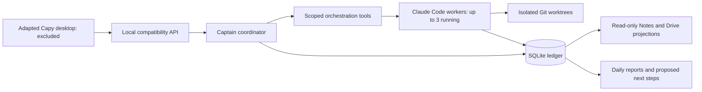

# Architecture

## Source map

| Area | Files |
| --- | --- |
| Coordinator, CLI lifecycle and scoped tools | `backend/server/engine.mjs`, `backend/server/mcp.mjs` |
| Durable records | `backend/server/store.mjs` |
| Process recovery and repository identity | `backend/server/process-recovery.mjs`, `backend/server/repository.mjs` |
| Task validation, reviews and source integration | `backend/task-*.mjs`, `backend/integration-plans.mjs` |
| Subscription environment and failure holds | `backend/subscription-environment.mjs`, `backend/runtime-failures.mjs` |
| Reports and scheduling | `backend/daily-report.mjs`, `backend/report-scheduler.mjs` |
| Desktop compatibility adapters, requiring excluded contracts | `backend/server.mjs`, `backend/runtime.mjs`, `backend/contracts.mjs`, `backend/ledger-drive.mjs`, related surfaces |

The database is authoritative. Notes and Drive are projections rather than separate task stores. Model claims cannot directly mark a task Done. Human review records acceptance; changing reviewed scope revokes current acceptance while retaining audit history.

Workers use exact Claude Code session identities. Restart recovery preserves queued instructions and requires explicit continuation instead of replaying side effects. Process identity checks guard against killing an unrelated process with a reused PID.

Writing workers require a committed Git repository root. Dirty base changes remain in place. Reassignment preserves workspace isolation. Integration records name one owner and verify that reviewed sources have not changed before proceeding.

Daily scheduling checks due times locally without a model. Catch-up produces only the latest missed report; generation and checkpoint commit together. Reports distinguish accepted work, pending integration and confirmed delivery evidence. Delivery cards record evidence; they do not execute deployment or merge commands.
